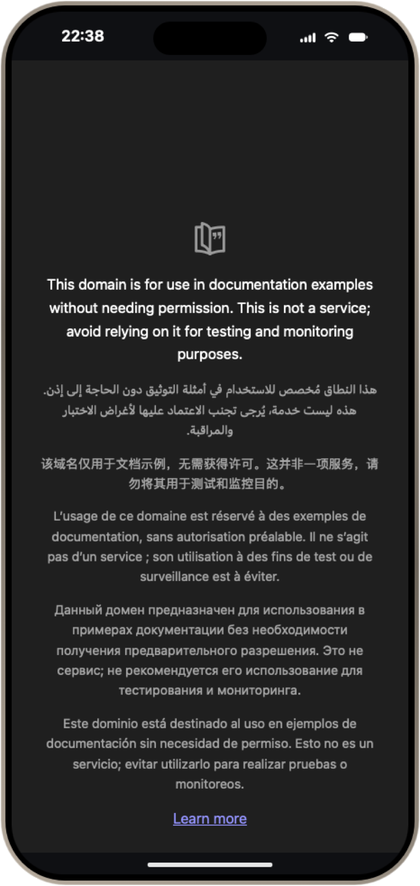

# mSTAGRAM

Instagram in its phone version, in a window styled as an iPhone, on your Mac.

## About
mSTAGRAM is made by Starbudweiser & Claude Code (Anthropic). Part of the **DESKTOP MAC TOOLKIT**. MIT License, © 2026 Starbudweiser. Provided as is, without warranty. "About mSTAGRAM" is in the app menu.

**mSTAGRAM is an independent project. It is not affiliated with, endorsed by or sponsored by Instagram or Meta. "Instagram" is a trademark of Meta Platforms, Inc.; no Instagram logo or brand asset is used here. The app only displays the public instagram.com website.**



## What it does
mSTAGRAM shows instagram.com in its **phone version**, inside a window styled as an **iPhone 17 Pro Max** (titanium frame, Dynamic Island, status bar). It presents itself as an iPhone, so the mobile layout is served. This is useful because some settings (for example the profile link) are only editable from the phone version. Instagram may still keep some settings reserved to its native app.

## Requirements
- macOS 13 or later, Apple Silicon (Mac with M-series chip).

## Installation
Download the latest `mSTAGRAM-<version>-macOS.zip` from the [Releases](https://github.com/starbudweiser/mSTAGRAM/releases) page, unzip it and move `mSTAGRAM.app` to your Applications folder. The app is signed with a Developer ID and notarized by Apple.

## Features
- Native macOS app in Swift (AppKit + WKWebView), no third-party dependency.
- Your login is kept between launches (standard WebKit storage on your Mac; nothing is sent anywhere else).
- Seven finishes (Finish menu): Natural, Black, White and Desert Titanium, Cosmic Orange, Deep Blue, Silver.
- Navigation menu: reload, back, home.
- Interface in French, English, Spanish and Italian (system language, English by default).
- Automatic updates from GitHub releases (daily check, Developer ID signature verified before replacement), with a manual "Check for Updates…" entry and an option to turn automatic installation off.
- Another site can be opened: `open -a mSTAGRAM --args https://example.com`.

## Build
```bash
./build_app.sh   # compiles, signs and installs to ~/Applications/Applications Personnelles
```
The version is read from `Resources/Info.plist`.

## License
MIT — see [LICENSE](LICENSE).

---

## Français
mSTAGRAM affiche Instagram en **version téléphone** dans une fenêtre habillée en iPhone, sur le Mac. Fait par Starbudweiser & Claude Code (Anthropic), il fait partie du **DESKTOP MAC TOOLKIT**.

**mSTAGRAM est un projet indépendant, ni affilié à, ni approuvé ou parrainé par Instagram ou Meta. « Instagram » est une marque de Meta Platforms, Inc. ; aucun logo ni élément de marque d'Instagram n'est utilisé. L'appli affiche seulement le site public instagram.com.**

- **Pourquoi** : certains réglages d'Instagram (par exemple le lien du profil) ne sont modifiables que depuis la version téléphone. mSTAGRAM se présente comme un iPhone ; Instagram peut tout de même réserver certains réglages à son appli native.
- **Configuration** : macOS 13 ou plus récent, Mac Apple Silicon.
- **Installation** : télécharger le zip depuis la page [Releases](https://github.com/starbudweiser/mSTAGRAM/releases), le décompresser et placer mSTAGRAM.app dans Applications. Signée Developer ID et notarisée.
- **Fonctions** : appli native Swift (AppKit + WKWebView) ; connexion conservée ; sept coloris (titane naturel, noir, blanc, désert, orange cosmique, bleu intense, argent) ; interface en français, anglais, espagnol et italien ; mise à jour automatique depuis les releases GitHub, avec recherche manuelle et option de désactivation.

Licence : MIT.
